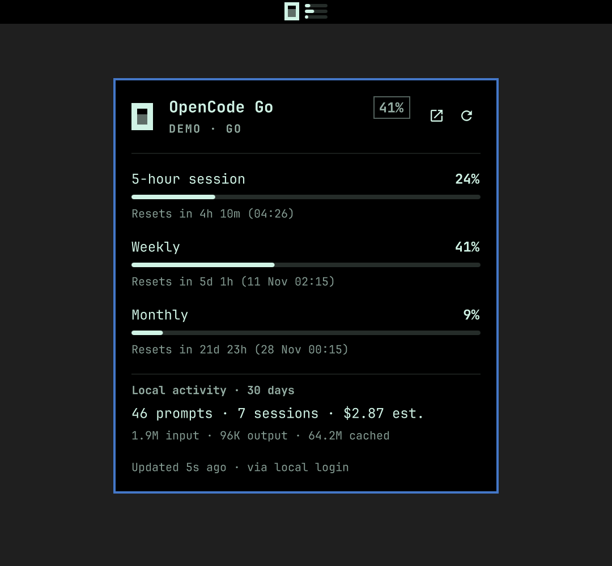

# OpenCode Go Usage

[](https://github.com/crueber/omarchy-plugin-opencode-usage/actions/workflows/validate.yml)

An Omarchy bar widget for your OpenCode Go allowance. It draws the OpenCode
mark in the bar with three small meters — 5-hour session, week, and month — and
opens a popup with percentages, reset countdowns, Console budgets, and local
activity.


The numbers come from the OpenCode service already running on your machine, so
there is no API key to paste and no second login:

```bash
opencode api GET /api/experimental/usage/limits
```

That endpoint reports the Go allowance and Console budgets of the workspace
your installed OpenCode is signed in to. If the background service is not
running, the widget retries once with `--standalone`, which starts a private
server for the request and reads the same credentials.

The endpoint is experimental, so a future OpenCode release may change its shape.



## What it shows

In the bar (default `bars` style):

- the OpenCode mark, drawn in QML so it follows the theme colour and stays crisp
- one meter per visible limit window, in session → week → month order
- the meters turn the warning colour at `warnPercent` and the urgent colour at
  `criticalPercent`

In the popup:

- **5-hour session**, **Weekly**, and **Monthly** rows with percentage, meter,
  and a reset countdown plus the absolute reset clock
- **Console budgets**, when the workspace has any
- **Local activity · 30 days**: prompts, sessions, tokens, and estimated cost
  from your local OpenCode history (`opencode stats --json`)
- links to your Console usage page, and a refresh action

## Install

Clone the repo and run the installer:

```bash
git clone https://github.com/crueber/omarchy-plugin-opencode-usage.git
cd omarchy-plugin-opencode-usage
./scripts/install.sh
```

The installer copies the runtime files to
`~/.config/omarchy/plugins/crueber.opencode-usage/`, validates the manifest, and
enables the widget in the right bar section. Pass another section as the first
argument (`left`, `centerBegin`, `center`, `centerEnd`, `right`).

To place it beside another widget after installing:

```bash
omarchy plugin enable crueber.opencode-usage --section right --after nino.tailscale
```

The widget hot-reloads when files are saved. If the popup keeps showing an old
build after a change, restart the shell once with `omarchy restart shell`.

## Use

- **Left click** — open or close the popup
- **Middle click** — refresh now
- **Right click** — open your Console usage page (or `onRightClick` if set)
- **`r`** — refresh while the popup is open

## Caching and request pacing

A shell restart creates a fresh QML engine, so the widget keeps its last
successful response on disk:

```
~/.cache/opencode-usage/usage.json
```

On startup it paints that response immediately and waits out the rest of the
refresh interval instead of asking again. The same file records the last
attempt time even when the request failed, so a restart loop — or a machine
where OpenCode is not running yet — does not hammer the service.

- Automatic refresh: `refreshIntervalSec`, default **5 minutes** (minimum 60
  seconds), measured from the last successful check.
- Manual refresh (`click`, `r`, middle click): at most once every **30
  seconds**; a click inside that window is deferred, not dropped.
- Failed checks back off from **1 minute up to 10 minutes**.
- One bar surface per monitor, but only the elected leader fetches; the others
  consume the published result.

## Development

This repository is the source of truth; the live plugin is
`~/.config/omarchy/plugins/crueber.opencode-usage/` and should be updated with
`./scripts/install.sh` rather than editing in place. `AGENTS.md` documents the
architecture invariants (fetch gate, cache schema, leader election, text
safety) for anyone — human or agent — changing the plugin.

```bash
./scripts/validate.sh   # manifest + required files; also runs in CI
./scripts/install.sh    # copy to the live plugin dir and enable
```

## Settings

Settings live inline on the widget's `shell.json` entry and are described in
`manifest.json`:

| Key | Default | Meaning |
| --- | --- | --- |
| `barStyle` | `bars` | `bars`, `text`, or `icon` |
| `showSession` | `true` | Show the 5-hour session meter |
| `showWeekly` | `true` | Show the weekly meter |
| `showMonthly` | `true` | Show the monthly meter |
| `refreshIntervalSec` | `300` | Poll interval (60–3600) |
| `warnPercent` | `70` | Warning threshold |
| `criticalPercent` | `90` | Critical threshold |
| `warningColor` | `#f67400` | Empty keeps the theme foreground |
| `criticalColor` | `""` | Empty uses the theme urgent colour |
| `opencodeCommand` | `""` | Optional path to the `opencode` binary |
| `showLocalStats` | `true` | Show local activity in the popup |
| `onRightClick` | `""` | Optional shell command |

For example:

```bash
omarchy bar set crueber.opencode-usage refreshIntervalSec 300
omarchy bar set crueber.opencode-usage barStyle text
```

## Requirements

- Omarchy with the Omarchy shell bar
- OpenCode v2.x, signed in to a workspace (`opencode auth list`)

## Licence

MIT
